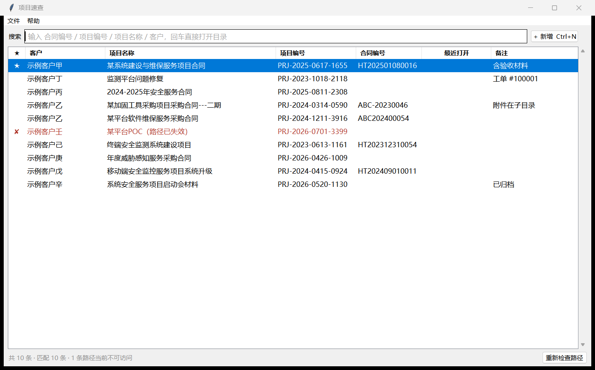
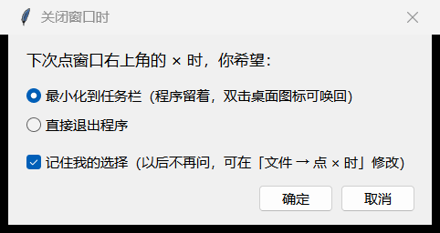

# 项目速查（Project Quick Find）

输入**合同编号 / 项目编号 / 项目名称 / 客户名**的任意片段，回车直接用资源管理器打开对应的本地资料目录。

Windows 单文件小工具 · Python + tkinter · 零第三方依赖 · 数据全部留在本机、程序不联网



- **单文件 exe（约 8.7 MiB）**，不装 Python、不装运行库
- 敲完关键词按回车就打开，不用再点选
- 记录存在本地 JSON 里，自动快照备份，坏了能回滚

---

## 目录

- [下载](#下载)
- [为什么用它](#为什么用它)
- [快速开始](#快速开始)
- [换机器 / 便携使用（只拷 exe 够不够）](#换机器--便携使用只拷-exe-够不够)
- [数据、备份与恢复](#数据备份与恢复)
- [功能说明](#功能说明)
- [快捷键](#快捷键)
- [关闭窗口时：退出还是最小化到任务栏](#关闭窗口时退出还是最小化到任务栏)
- [右键菜单](#右键菜单)
- [从源码构建](#从源码构建)
- [已知限制](#已知限制)
- [仓库结构](#仓库结构)
- [版本](#版本)
- [变更记录](#变更记录)
- [许可](#许可)

---

## 下载

**开箱即用**：到 [Releases](../../releases/latest) 下载 `project-quickfind-1.1.1.exe`，双击运行即可（文件名可自己改成 `项目速查.exe`，不影响功能），不需要装 Python。

**想自己构建**：见[从源码构建](#从源码构建)。

> 未签名程序：个别杀软/浏览器会提示「未知发布者」，选择保留即可。程序不联网、不写系统目录，全部代码都在本仓库里可审。

---

## 为什么用它

手里的项目是几十个量级，同一个客户还常有好几个项目。资料按 `客户目录 / 【项目编号】项目名称` 分层存放，于是每次找一份合同都要：

```
打开 D:\资料库 → 找到客户 → 找到项目 → 再点进子目录
```

有了这个工具，同样的动作变成：

```
双击图标 → 敲 "客户 维保" → 回车
```

它不搬运、不改动你的任何文件，只做一件事：**把"我记得那个项目叫什么"翻译成"资源管理器跳到那个目录"**。

---

## 快速开始

1. 双击 `项目速查.exe`
2. 光标已经在搜索框，直接输入，例如：

   | 输入 | 命中 |
   |---|---|
   | `PRJ-2025-0617` | 按项目编号前缀 |
   | `HT202501080016` | 按合同编号 |
   | `客户 维保` | 客户 + 关键词，空格分隔取交集 |
   | 简称 | 自动匹配全称（内置十几条常见简称，见源码 `ABBR`，可自行增删） |
   | `（ABC202500054）` | 全角括号、全角数字照样能搜 |

3. 列表里第一条已经是高亮的，**回车即打开**。也可以 ↓ 进列表挑一条再回车，或直接双击。

第一次打开是空的，界面中央有引导文字。往窗口里**拖一个项目文件夹**就能建第一条记录。

---

## 换机器 / 便携使用（只拷 exe 够不够）

**结论：程序只要一个 exe；但你的记录不在 exe 里。**

exe 是程序本体（Python 运行时已打包进去），记录是另一个 JSON 文件。所以按你的目的选：

| 你的目的 | 需要拷贝什么 | 拷到哪 |
|---|---|---|
| 新机器只要能运行，记录重新录 | **只拷 `项目速查.exe`** | 任意目录，双击即用 |
| 把已有记录一起搬过去 | `项目速查.exe` **+** `pmindex.json` | exe 随便放；json 放 `%APPDATA%\项目速查\` |
| 做绿色便携版（U 盘/多机共用） | `项目速查.exe` **+** `pmindex.json` | **两者放同一个文件夹**，整夹拷走 |

### 方式 A：常规迁移（推荐）

1. 旧机器上按 `Win + R`，输入 `%APPDATA%`，回车
2. 打开 `项目速查` 文件夹，把里面的 **`pmindex.json`** 复制走
   - 程序里也可以点菜单 **文件 → 打开数据文件位置**，直接跳到这里
3. 新机器上放好 `项目速查.exe`
4. 再次 `Win + R` → `%APPDATA%` → **新建文件夹** `项目速查` → 把 `pmindex.json` 粘进去
5. 启动 exe，记录全在

`backups` 子目录**不必拷**（想连历史备份一起带走也可以，程序会自动识别）。

### 方式 B：便携模式（U 盘、临时机器）

把 `项目速查.exe` 和 `pmindex.json` 放进**同一个文件夹**，程序会优先读同目录的 json，不再碰 `%APPDATA%`。

判断规则（优先级从高到低）：

1. 环境变量 `PMINDEX_DATA_DIR` 指定的目录
2. **exe 所在目录有 `pmindex.json`** → 用它（便携模式）
3. 以上都没有 → `%APPDATA%\项目速查\`

> 换句话说：exe 旁边**没有** json，就走 `%APPDATA%`；exe 旁边**有** json，就只认它。

### 不需要拷的东西

- `_src\` —— 源码，只有想改代码或重新打包时才需要
- `backups\` —— 历史快照，新机器上程序会重新生成
- `app.log` —— 出错日志，排障时才看

### 注意：资料目录路径不会自动跟着变

记录里存的是**绝对路径**（如 `D:\资料库\202601示例客户\【项目编号】项目名称`）。如果新机器上资料放在别的盘符或别的目录，会出现两种情况：

- 列表里整片变**红字 + ✘**，状态栏提示"N 条路径当前不可访问"
- 双击打不开

三种处理办法，按省事程度排序：

1. **保持相同的盘符与目录结构**（最省事，拷完就能用）
2. 在程序里选中记录按 **F2**，点「选择…」重新指一下（适合只改几条）
3. **批量改前缀**：关掉程序，用记事本打开 `pmindex.json`，把 `D:\\资料库` 全部替换成新盘符下的路径，保存后重开
   （json 是 UTF-8 纯文本，一条记录一段，改完程序会自动重新检查路径）

---

## 数据、备份与恢复

### 数据文件

| 项 | 说明 |
|---|---|
| 主数据 | `pmindex.json`，UTF-8 无 BOM，缩进 2，可直接用记事本改 |
| 默认位置 | `%APPDATA%\项目速查\pmindex.json`（即 `C:\Users\<你>\AppData\Roaming\项目速查\`） |
| 便携位置 | exe 同目录下的 `pmindex.json`（存在则优先） |
| 备份 | 同目录 `backups\pmindex-YYYYMMDD-HHMMSS.json`，**保留最近 10 份** |
| 日志 | 同目录 `app.log`，仅在启动或出错时写入 |

### 备份策略

**每次保存成功后立刻做一次快照**，内容与最新备份相同则跳过，超过 10 份自动删最旧的。

这样做的好处是备份永远不落后于真实数据 —— 就算文件被外部改坏，最多只损失"最后一次操作"。

写入本身也是原子的：先写 `.tmp`、刷盘，再替换主文件。中途断电不会留下半个 JSON。

### 文件被改坏了怎么办

启动时如果 `pmindex.json` 解析失败，程序会：

1. 把坏文件改名保留为 `pmindex.json.bad-<时间戳>`（不会删掉，留着取证）
2. 自动从最近一份能解析的备份恢复
3. 状态栏显示"已从备份恢复"

也可以手动恢复：菜单 **文件 → 从备份恢复…**，选一个时间点覆盖（覆盖前会先把当前数据再备份一份）。

### 手动备份

菜单 **文件 → 立即备份**，立刻生成一份快照。

---

## 功能说明

### 搜索

- **任意片段匹配**：客户、项目名称、项目编号、合同编号、备注、完整路径，六个字段一起搜
- **空格分词取交集**：`客户 维保` = 同时包含这两个词
- **归一化处理**：全角括号/全角数字/大小写差异都能匹配；粘进来的 `（ABC202500054）` 会自动剥掉两端标点
- **简称展开**：内置十几条常见机构简称，输入简称即可命中全称（示例表在源码顶部 `ABBR`，按自己客户的叫法直接增删即可）

### 排序与置顶

- 默认顺序：**置顶项** → 最近打开时间倒序 → 客户 + 项目名称
- 点任意**列头**切换该列升/降序，表头会出现 ▲ / ▼
- 点最左侧 **★** 列头 = 切换当前选中记录的置顶（置顶项永远排最前，不会被排序打散）

### 录入（三种方式，都不用打字填五个框）

1. **拖文件夹（或单个文件）进窗口** —— 最省事。程序自动从目录名解析：
   - 客户名：取上一级目录名，剥掉 `202608` / `202609_` / `202610-` / `2026` 这类年月前缀
   - 项目编号 + 项目名称：拆 `【PRJ-2025-0617-1655】项目名称`
   - 合同编号：识别 `-HT202501080016`、`(ABC202400054)`、`（ABC202500054）`、`ABC-20230046` 等写法，并从名称里去掉（避免和「合同编号」列重复）
2. **Ctrl+V 粘贴路径** —— 在资源管理器里 Shift+右键「复制为路径」，回到程序 Ctrl+V；检测到是存在的目录会直接问你要不要新增。拖拽被系统权限拦住时（例如程序以管理员运行时）用这条
3. **Ctrl+N 手工新增** —— 填客户、名称、编号、路径；选完目录后仍会自动预填，**已填的字段不会被覆盖**

保存时只校验路径是否存在（不存在会问一句「仍然保存？」，可以保存待恢复的记录）。

### 路径健康检查

启动后在后台线程逐条检查路径，**不阻塞界面**：

| 标记 | 含义 |
|---|---|
| `★` | 已置顶 |
| `✘` + 红字 | 路径当前不存在（目录被移走、网盘/移动盘未挂载） |
| `?` | 路径超长（>240 字符），受限未能确认，不当作失效 |
| 无标记 | 正常 |

状态栏显示「共 N 条 · 匹配 M 条 · K 条路径当前不可访问」，右侧有「重新检查路径」按钮（插上移动硬盘后点一下即可）。

### 打开行为

- 记录指向**目录** → 打开资源管理器
- 记录指向**文件**（比如某份合同扫描件）→ 用默认程序打开该文件
- 右键「在上级目录中定位」= 打开父目录并选中它
- 右键「打开客户根目录」= 跳到记录路径的上一级（同客户其它项目就在旁边）

---

## 快捷键

| 按键 | 作用 |
|---|---|
| `Ctrl + N` | 新增记录 |
| `Ctrl + F` | 回到搜索框并全选 |
| `↑` / `↓` | 在搜索框里就能上下移动列表选中项 |
| `Enter` | 打开当前高亮的记录 |
| `F2` | 编辑当前记录 |
| `Delete` | 删除当前记录（确认框会显示项目名和完整路径） |
| `Esc` | 清空搜索（已空则回到搜索框） |
| `Ctrl + Q` | 退出程序 |
| 双击行 | 打开 |
| 右键行 | 上下文菜单 |

菜单 **帮助 → 快捷键与用法** 里也有一份（离线可看）。

> 如果中文输入法回车选词会误触发打开，把源码里 `ENTER_IN_SEARCH_OPENS` 改成 `False` 重新打包即可，回车就只把焦点移进列表。

---

## 关闭窗口时：退出还是最小化到任务栏

第一次点窗口右上角的 ×，会先问你一句：

```
下次点 × 时，你希望：
  ● 最小化到任务栏（程序留着，双击桌面图标可唤回）
  ○ 直接退出程序
  ☑ 记住我的选择（以后不再问）
```



- 选**最小化到任务栏**：窗口收进任务栏，程序留在后台。之后双击桌面图标（或从任务栏点回来）就能继续用，省掉重新启动那 2 秒
- 选**直接退出**：和普通程序一样，点 × 就关掉，数据自动保存
- 勾了「记住」就按记忆执行，不再打扰你
- 想改：菜单 **文件 → 点 × 时**，三个选项随时切换（选「每次询问」就会恢复成每次弹框）
- `Ctrl + Q` 任何时候都是**直接退出**，不受这个设置影响
- 已经最小化时，再从任务栏右键「关闭窗口」会真的退出（不会卡在"越点越缩起来"的状态）

---

## 右键菜单

| 菜单项 | 说明 |
|---|---|
| 打开（回车） | 打开目录/文件 |
| 在上级目录中定位 | 打开父目录并选中当前项 |
| 打开客户根目录 | 跳到上一级，方便看同客户其它项目 |
| 复制路径 / 复制项目名称 | 复制到剪贴板 |
| 编辑（F2） / 删除（Del） | 修改 / 删除 |
| 置顶 / 取消置顶 | 切换置顶 |

---

## 从源码构建

要求：Windows + 一个带 tkinter 的 Python 3.11（`py -3.11-32` 或你环境里的 `python`）。

```bat
py -3.11-32 -m venv _build\venv
_build\venv\Scripts\python.exe -m pip install pyinstaller==6.22.3

cd _build
_build\venv\Scripts\python.exe -m PyInstaller --onefile --windowed --clean ^
  --icon ..\_src\app.ico --name 项目速查 ..\_src\pmindex.pyw
```

产物是 `_build\dist\项目速查.exe`，覆盖旧版即可（**数据不受影响**，数据在 `%APPDATA%`）。

说明：

- PyInstaller 必须装进 **venv**；用基础解释器 `-m pip install` 会装到系统 Python 里
- 上面用 32 位解释器，产物 32 位、64 位 Windows 都能跑；换 64 位 Python 构建则得到 64 位产物
- `6.22.3` 是实测可用的版本
- 打完可删掉整个 `_build` 目录，需要时按上面命令重建

源码结构（`_src\pmindex.pyw`，2008 行，零第三方依赖）：

| 区块 | 内容 |
|---|---|
| §0 常量 | 列定义、正则、简称表 |
| §1 Bootstrap | DPI 感知、无控制台下的 stdio 兜底、异常钩子、单实例互斥 |
| §2 数据层 | `DataStore`：原子写、快照、损坏恢复、增删改 |
| §3 解析 | 从目录名推断客户/项目编号/名称/合同号 |
| §7 系统集成 | 打开目录、在上级定位、拖拽（WM_DROPFILES） |
| §6 编辑对话框 | `RecordDialog` |
| §5 主窗口 | `App`：过滤、排序、差异刷新、路径检查线程 |
| §8 main | 启动装配 |

自测（纯标准库，不依赖 pytest）：

```bat
py -3.11-32 _src\test_parse.py
py -3.11-32 _src\test_store.py
py -3.11-32 _src\test_ui.py
```

---

## 已知限制

- **首次启动约 2 秒**：单文件模式要先把本体解压到 `%TEMP%`。这是 onefile 的固有代价，换目录模式（`--onedir`）能秒开但会变成一堆文件
- **未签名**：个别企业杀软会提示"未知程序/正在扫描"，加一次信任即可；程序不联网、不写系统目录
- **32 位程序**：64 位 Windows 可直接运行
- **记录使用绝对路径**：换机器或挪动资料目录后需要按上文「注意」一节处理
- **不支持拼音首字母搜索**（如用 `nh` 搜「农行」）：需要引入第三方库，目前没做
- **拖拽依赖 Windows 窗口子类化**（接收 `WM_DROPFILES`）。正常情况已验证通过，程序也内置了自检：命令行跑 `项目速查.exe --selftest-drop "D:\任意项目目录"`，会模拟一次拖放并自动退出，数据目录里的 `selftest_result.txt` 写 `OK` 即正常。万一在某台机器上拖入后仍然异常，**在 exe 旁边（或数据目录）新建一个空的 `nodrag.txt`**，程序就不装拖拽了，改用 `Ctrl+V` 粘贴路径，其余功能完全不受影响
- **单实例**：程序已在运行时再启动一次，只会把已有窗口提到前台并退出，避免两个进程互相覆盖数据
- **不做文件内容检索**：只匹配记录的字段和路径，不读文档正文
- **批量导入未做**：目前靠"拖文件夹"逐条录入

---

## 仓库结构

```
project-quickfind\
├── README.md             ← 本文件
├── LICENSE               ← MIT
├── .gitignore
├── .gitattributes        ← 统一 LF，二进制文件标记
├── assets\               ← README 用图
│   ├── main-window.png
│   └── close-dialog.png
└── _src\                 ← 源码与自测脚本
    ├── pmindex.pyw       主程序（单文件，零第三方依赖）
    ├── make_icon.py      生成 app.ico（纯标准库）
    ├── app.ico           程序图标
    ├── test_parse.py     解析函数自测
    ├── test_store.py     数据层自测（含损坏恢复、备份轮换）
    ├── test_ui.py        界面与关闭行为自测
    ├── shot.py           窗口截图工具
    ├── capture_running.py 按标题截取运行中的窗口
    ├── verify_close.py   对运行中的 exe 验证「点 × 」询问框
    ├── measure_startup.py 实测启动耗时
    └── demo_shot.py      造演示数据出图核对版面
```

exe 不进仓库，放在 [Releases](../../releases/latest)。

运行期生成（不在仓库里）：

```
%APPDATA%\项目速查\
├── pmindex.json          ← 你的记录（要迁移就拷它）
├── backups\              ← 最近 10 份快照
└── app.log               ← 日志
```

---

## 版本

| 项 | 值 |
|---|---|
| 版本 | 1.1.1 |
| 打包 | PyInstaller 6.22.3，onefile + windowed，32 位 |
| 实测环境 | Windows 10 / 11（在 Windows 11 24H2 上实测） |
| 构建日期 | 2026-10-25 |

---

## 变更记录

### 1.1.1 — 2026-10-25

**优化：帮助与「关于」里的数据路径改为占位符显示。**

- 「数据位置」不再打印完整绝对路径，改为 `%APPDATA%\项目速查\pmindex.json` 这种带环境变量占位符的写法
- 涉及范围：帮助、关于、备份完成提示、删除确认、打开失败提示、恢复确认、路径不存在提示
- 同时：帮助窗口高度按内容自适应并加滚动条（之前「数据位置」被挤出可视区），
  帮助内容补上 `Ctrl+Q` 与「点 × 时」的说明，「关于」里显示版本号

### 1.1.0 — 2026-10-25

**新增「点 × 时的行为」设置。**

- 第一次点 × 会问一次：最小化到任务栏 / 直接退出，可选「记住我的选择」
- 随时可在 **文件 → 点 × 时** 改（每次询问 / 直接退出 / 最小化到任务栏）
- 新增 `Ctrl + Q` 直接退出，不受该设置影响
- 已最小化时从任务栏右键关闭 → 真退出，不会卡住关不掉

### 1.0.1 — 2026-10-25

**修复：拖入文件夹时程序闪退。**

- 现象：把项目目录拖进窗口，程序直接消失，`app.log` 里没有任何异常
- 定位：Windows 事件日志显示崩溃码 `0xC0000409`（`STATUS_STACK_BUFFER_OVERRUN`）、WER 类型 `BEX`、出错模块 `ucrtbase.dll` —— 属于 C 运行时 abort，Python 层抓不到
- 原因：旧实现把 Tk 回调（`after_idle` 里弹模态窗口）排进了 `WM_DROPFILES` 的窗口过程里执行，等于在 Win32 消息派发中途再开一层 Tcl 事件循环，把运行时栈搞坏
- 改法：窗口过程只做 `DragQueryFile` + 把路径丢进队列，**完全不碰 Tk**；弹窗改由主线程的 `after` 定时器消费队列时触发；同时给所有 Win32 调用补上 `argtypes`/`restype`，并加"同一时间只允许一个编辑框"的护栏
- 附带：拖入的内容支持单个文件（不再只限文件夹）；多选只取第一个并在状态栏提示；新增 `nodrag.txt` 逃生开关和 `--selftest-drop` 自检

### 1.0 — 2026-10-25

首个版本。搜索/排序/置顶、拖拽与粘贴录入、路径健康检查、自动备份与损坏恢复、单文件 exe 打包。

---

## 许可

[MIT](LICENSE) © 2026 linuxying
